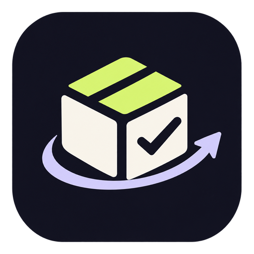

<p align="center">
  
</p>

# AfterCart

**AfterCart turns forgotten purchases into actionable next steps.** It checks return-window dates, surfaces upcoming deadlines, prepares return/warranty/repair case drafts, and remembers their status across restarts.

> Hackathon prototype: this project uses clearly labelled sample purchases stored locally. It does not connect to Amazon orders, retailer accounts, repair shops, or payment services. Confirming a case updates only the local demo record.

## Prerequisites

- Node.js 22 LTS (npm is included)
- Visual Studio Code
- An internet connection for the first dependency installation

## Run locally

1. Download and unzip this project.
2. In VS Code, choose **File → Open Folder…** and open the `aftercart-v0.5.0` folder.
3. Open **Terminal → New Terminal**.
4. Confirm Node is installed:

   ```bash
   node -v
   npm -v
   ```

5. Install packages once:

   ```bash
   npm install
   ```

6. Start both the MCP server and web interface:

   ```bash
   npm run dev
   ```

7. Open **http://127.0.0.1:5173** in your browser. Leave the terminal running while you use the app.

The browser uses the official MCP TypeScript SDK client to connect to the local Streamable HTTP endpoint at `/mcp`. The backend registers real MCP tools; the UI calls them over MCP rather than faking a list of tool calls. Tool replies now carry a visible provenance chip, and the MCP activity drawer shows tool name, input arguments, a concise result summary, status, timestamp, and elapsed time when available. The server binds to `127.0.0.1` and checks browser `Origin` headers against an explicit local allowlist; the CLI verifier, which omits `Origin`, remains usable.

## Current MCP tools

- `list_purchases` — list/filter sample purchases.
- `get_attention_summary` — calculate return deadlines coming up in the next seven days and list past windows/drafts.
- `get_purchase_options` — show possible return, warranty, and repair next steps for one or all sample purchases without creating a case.
- `check_return_eligibility` — compare a demo deadline with the current date.
- `prepare_case` — create a locally saved return, warranty, or repair draft.
- `list_cases` — retrieve saved case records.
- `confirm_case_action` — explicitly mark a local demo draft as confirmed. No external service is contacted.

## Try these prompts

- “What needs attention this week?”
- “Can I return EchoTone Wireless Headphones?”
- “Prepare a return for EchoTone Wireless Headphones.”
- “Show my cases.”
- “Prepare a warranty case for BrewMate Mini Coffee Maker.”

## Run the intent-router tests

The intent router is deliberately deterministic in this version. The built-in Node.js tests cover product matching, read-only options requests, explicit draft preparation, clarification behavior, and the local MCP Origin allowlist:

```bash
npm test
```

## Verify the MCP server end-to-end

Keep the app running in one VS Code terminal with `npm run dev`. Open a **second** terminal in the project folder and run:

```bash
npm run verify:mcp
```

This verification script uses the official MCP TypeScript client to complete the initialize handshake, call `tools/list`, confirm that all seven tools are registered, and make read-only `tools/call` requests for purchase listing, support options, the attention summary, and a return-window check. It does not create or confirm a case. A successful run ends with `MCP SMOKE TEST PASSED`. To target another local endpoint, set `MCP_URL` before running the script.

The installed `@modelcontextprotocol/sdk` v1.x line implements the 2025-11-25 protocol revision, which meets the Alexa+ track's published minimum requirement. The test proves the server is reachable and its tools work through MCP; keep the terminal output as evidence while recording the demo.

## Reset the sample data

Stop the dev server with `Ctrl+C`, then run:

```bash
npm run reset:demo
npm run dev
```

This recreates sample purchase dates relative to the current date and clears saved demo cases.

## Project structure

```text
aftercart-v0.5.0/
├── client/
│   ├── public/
│   │   └── aftercart-logo.png  # Brand mark and browser favicon
│   ├── index.html
│   └── src/
│       ├── App.jsx             # Dashboard, chat, cards, user actions
│       ├── main.jsx            # React entry point
│       ├── styles.css          # App styling and responsive layout
│       ├── lib/mcpClient.js    # Browser MCP client + tool-call helper
│       └── lib/intentRouter.js # Tested deterministic intent routing
├── server/
│   ├── index.js                # Express server + Streamable HTTP /mcp endpoint
│   ├── tools.js                # MCP tool definitions and business logic
│   └── security.js             # Local MCP Origin allowlist
│   └── store.js                # Local JSON persistence + sample records
├── tests/
│   ├── intentRouter.test.js    # Node built-in tests for request routing
│   └── security.test.js        # MCP Origin allowlist tests
├── scripts/
│   └── reset-demo.js           # Reset sample records
├── data/                       # Runtime data is generated here; ignored by Git
├── docs/
│   ├── demo-script.md          # Suggested demo flow
│   ├── submission-checklist.md # Final build/Devpost checklist
│   └── product-feedback-template.md # Fill from actual developer experience
├── .vscode/extensions.json     # Optional editor extension recommendations
├── .env.example
├── .gitignore
├── LICENSE
├── package.json
└── vite.config.js
```

## Useful commands

- `npm run dev` — start the web app and server.
- `npm run build` — build the frontend for production packaging.
- `npm run reset:demo` — reset local demo records.

## Known limitations

- Intent routing is deterministic and does not use a language model yet. It calls real MCP tools when the user chooses one of the supported intents; unsupported/ambiguous requests receive a clarification instead of a guessed mutation.
- Purchases and service cases are local sample data. There is no real retailer integration. Warranty and return dates are illustrative, not a retailer decision or guarantee of coverage.
- This is a local hackathon prototype, not an authenticated multi-user production service. Do not put personal order details into it.

## Before submission

Test the complete flow on the machine used to record the demo. The Alexa+ hackathon rules call for a working MCP server on Streamable HTTP (specification version 2025-11-25 or later) or a clearly identified simulated Alexa+ experience. Record the MCP endpoint and tool calls in the demo. Publish/share the repository according to the current Devpost submission instructions, include the required license if public, and provide honest tool feedback and any real friction logs.


## Design system

AfterCart uses a signature **deep ink + warm paper + electric citron** palette. The dark navigation and hero create a recognizable product frame, warm off-white surfaces keep purchase details readable, and citron is reserved for primary actions, safety cues, and the deadline radar. Motion is intentionally restrained and respects `prefers-reduced-motion`.

The app is a demo workspace with seeded sample purchase records. It does not connect to retailer accounts, and “Confirm in demo” updates only local demo case state. Keep this distinction visible in screenshots, the product description, and the demo video.
